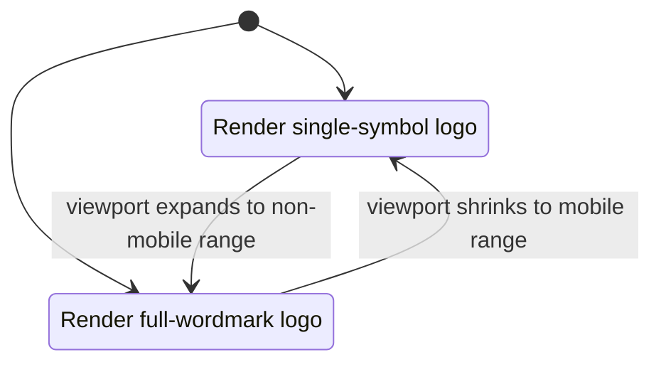

# Data Model: Mobile Single Logo

**Feature**: 023-mobile-single-logo | **Date**: 2026-07-27

No database or API data model changes. This feature's model is a UI presentation model
that maps viewport size and surface type to a logo variant.

## Entities

### BrandingSurface

Represents a UI location where brand identity is rendered.

| Field | Type | Rules |
|-------|------|-------|
| `surfaceId` | enum | `auth-login`, `auth-register`, `auth-reset`, `home-header` |
| `isInteractive` | boolean | `true` for clickable brand links, `false` for static brand slots |
| `accessibleName` | string | Must represent brand identity consistently ("Vii Pass") |
| `roleScope` | enum | `public`, `authenticated-admin`, `authenticated-normal` |

### LogoVariant

Represents available visual logo assets.

| Field | Type | Rules |
|-------|------|-------|
| `variant` | enum | `full-wordmark`, `single-symbol` |
| `assetPath` | string | Stable public asset path under `/logo/*` |
| `fallbackText` | string | Brand label shown/announced if image unavailable |

### ViewportRule

Defines when each variant is used.

| Field | Type | Rules |
|-------|------|-------|
| `ruleId` | enum | `mobile`, `non-mobile` |
| `viewportRange` | range | `mobile` = below Bootstrap `sm`; `non-mobile` = at/above `sm` |
| `appliesToSurfaces` | list | All in-scope `BrandingSurface` entries |
| `targetVariant` | enum | `mobile -> single-symbol`, `non-mobile -> full-wordmark` |

## Relationships

## State Transitions

## Invariants

- Desktop/tablet presentation remains unchanged from current behavior.
- Mobile presentation never shows the full-wordmark logo on in-scope surfaces.
- Brand interactions (click/tap behavior where present) are unchanged across variants.
- Role does not alter which logo variant is shown for a given viewport rule.
